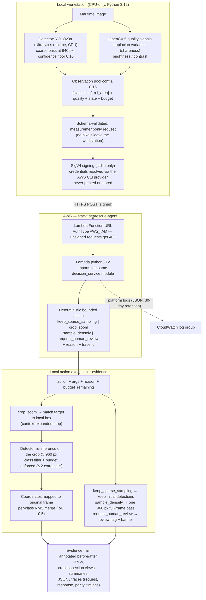

# SeaRescue Agent

**An agentic maritime vision system that detects people in water from UAV
imagery, re-examines uncertain regions of the frame on demand, and leaves an
auditable evidence trail for every decision it makes.**

Built for the OpenCV AI Competition 2026 (powered by AWS).

---

## The problem

Aerial search-and-rescue is a hard detection problem. A swimmer's head can
occupy only a handful of pixels in a high-resolution frame; small targets sit
far from the camera; and running high-resolution inference over every frame is
neither fast nor cheap on edge hardware. A fixed single-scale detector is
forced into a compromise: miss small victims, or spend compute everywhere.

SeaRescue Agent takes a different approach. A lightweight detector scans the
whole frame, quantifies its own uncertainty, and asks a deployed decision
service whether a bounded region deserves a closer look — instead of
escalating everything. The result is a system that spends its compute budget
only where the evidence says to, and can show exactly what it did, why, and
what the outcome was.

## System overview

Each image goes through a bounded agent loop:

1. **Measure** — OpenCV quality signals (Laplacian-variance sharpness,
   brightness, contrast) plus a full-frame 640 px detector pass produce
   detections with confidence scores.
2. **Observe** — a schema-validated, measurement-only observation is built:
   detection classes, confidences, relative areas, quality signals, agent
   state, and remaining budget. No image pixels are sent anywhere.
3. **Decide** — the observation is sent to an AWS Lambda decision service over
   an IAM-authenticated Function URL (SigV4-signed, stdlib-only signer). The
   service deterministically returns one of `keep_sparse_sampling`,
   `crop_zoom`, `sample_densely`, or `request_human_review`, with a reason and
   a trace id derived from the request content.
4. **Act** — the action executes locally under a strict budget (e.g.
   `crop_zoom` runs exactly one 960 px re-inference on a context-expanded crop
   of the matched region, with coordinates mapped back to the original frame
   and a per-class NMS merge).
5. **Record** — every step is written to a JSONL trace: the observation sent,
   the endpoint response, executed extra inferences (including raw crop
   results), merge/NMS accounting, and timings. Annotated before/after images
   and machine-readable summaries accompany each trace.



The same decision logic runs in two places: locally (for offline experiments)
and inside the Lambda (for live decisions). Both paths are exercised by the
test suite, and the demo traces record parity between the two.

## How it is built

| Layer | Choice | Notes |
|---|---|---|
| Vision | **OpenCV 5** (`opencv-python==5.0.0.93`, the only OpenCV package) | quality signals, geometry, image IO |
| Detection | YOLOv8n via Ultralytics 8.4.177, CPU | weights trained on SeaDronesSee-derived data; not shipped (AGPL) |
| Decision service | AWS Lambda `python3.12`, 256 MB, 10 s | deployed via SAM template (`aws/template.yaml`) |
| Endpoint | Function URL, AuthType **AWS_IAM** | unsigned requests get 403 before invocation |
| Permissions | execution role with `AWSLambdaBasicExecutionRole` only | least privilege |
| Signing | stdlib-only SigV4 module (`scripts/aws_sigv4.py`) | no SDK in the request path |
| Tests | **74 offline tests** (pytest) | includes AWS template invariant guards; no live AWS in unit tests |
| Runtime | Python 3.12, NumPy 2.x, CPU only | reproducible on a plain laptop |

## Results

Measured on labelled validation subsets (IoU 0.5, operating confidence 0.25,
CPU). These are small samples used for engineering decisions — **not
benchmarks**.

Detection quality (32-image development subset):

| Configuration | Precision | Recall | F1 | mAP50 | s / image |
|---|---|---|---|---|---|
| Fixed 640 px | 0.7113 | 0.7188 | 0.7150 | 0.6748 | 0.079 |
| Fixed 960 px | 0.7703 | 0.8385 | 0.8030 | 0.7854 | 0.149 |
| Adaptive (v2 policy) | 0.7340 | 0.7188 | 0.7263 | 0.6630 | — |

Two additional untouched 16-image subsets measured F1 0.7547 and 0.7955.

Agentic behavior (from run traces): the bounded v2 policy escalates 62 % of
images (v1 escalated 84 %) while spending 0.4 Mpx of extra resolution (v1:
73.6 Mpx) — re-examination is bounded by design.

Live end-to-end demo over the deployed AWS endpoint (8 images): 8/8 signed
requests reached the service and returned HTTP 200 with a server decision;
7 `crop_zoom` actions each executed exactly one local 960 px crop
re-inference; cloud/local trace-id parity and decision agreement were 8/8;
round-trip latency 94–1244 ms.

**A measured negative result, stated plainly:** on the live demo subset, the
adaptive loop recovered **zero net new detections above the operating
threshold**. The demo shows the loop working end-to-end and being honest
about it — for example, `10417.jpg`'s crop call returned 3 raw detections,
of which 0 passed the operating threshold, and the exact NMS suppression
chain is documented in
[`docs/evidence-notes-10417.md`](docs/evidence-notes-10417.md).

## Getting started

Requires Windows PowerShell (tested), Python 3.12, and a local copy of the
repository.

```powershell
python -m venv .venv
.\.venv\Scripts\Activate.ps1
python -m pip install --upgrade pip
pip install -r requirements.txt
```

`requirements.txt` pins the full stack (OpenCV 5, Ultralytics, CPU-only torch,
NumPy 2.x). Detector weights are **not** shipped with the repository — place
them at `weights/best.pt` (see `docs/licensing-notes.md` for provenance).
Dataset images are likewise not included; point the commands below at your own
local copy of SeaDronesSee validation images.

```powershell
python scripts/smoke_cv2.py           # OpenCV 5 smoke test -> PASS
python -m pytest tests -q             # 74 offline tests

# single-image adaptive agent (decisions computed locally)
python scripts/agentic_detect.py --input <image.jpg> --output out\single --policy v2

# labelled-set evaluation (fixed vs adaptive -> results.json per run)
python scripts/evaluate.py            # see script help for arguments

# video loop on owned clips
python scripts/analyze_video.py --input <clip.avi> --output out\video --decision service

# same demo pipeline fully offline (no network, labelled local policy)
python scripts/demo_live_agent.py --input <image.jpg> --output out\local --mode local-policy

# live end-to-end demo against the deployed AWS decision service
python scripts/demo_live_agent.py --images <your local val image dir> `
    --limit 8 --output output\demo_live --mode live-aws `
    --function-name searescue-agent-DecideFunction-<your-suffix>
```

Live mode resolves credentials through the AWS CLI profile you configure, in
memory, and refuses to fall back on authentication failure — the demo either
talks to the real service or exits.

## Repository layout

```
scripts/   detector, evaluator, decision service (shared local/Lambda),
           Lambda handler, live demo agent, SigV4 signer, video analyzer,
           smoke test
tests/     74 offline unit tests, incl. AWS template guard tests
aws/       template.yaml — the deployed SAM template
docs/      technical report, architecture diagram source, evidence manifest,
           NMS audit notes, licensing notes, demo script, Devpost draft
output/    preserved evidence & evaluation artifacts (gitignored)
data/      local dataset mirror (gitignored; never shipped)
weights/   detector weights (gitignored; never shipped)
```

## Documentation

- [`docs/technical-report.md`](docs/technical-report.md) — full report:
  problem, architecture, evaluation, security, reproduction, limitations.
- [`docs/architecture.mmd`](docs/architecture.mmd) — architecture diagram
  source (rendered above).
- [`docs/evidence-manifest.csv`](docs/evidence-manifest.csv) — representative
  live-demo examples with verified checksums, decisions, and trace ids.
- [`docs/evidence-notes-10417.md`](docs/evidence-notes-10417.md) — audited NMS
  suppression-chain notes for the `10417.jpg` example.
- [`docs/licensing-notes.md`](docs/licensing-notes.md) — licensing facts and
  the open review checklist.
- [`docs/demo-script.md`](docs/demo-script.md), `docs/devpost-draft.md` —
  competition walkthrough and submission text.

## Security and privacy

- The endpoint accepts only **AWS_IAM**-authenticated requests; unsigned
  requests receive 403 *before* the function is invoked (verified live,
  including a credential-free probe).
- Credentials are resolved through the AWS CLI profile, held in memory, and
  never printed, stored, or written into traces.
- No real AWS resource identifiers are embedded in this repository: endpoint
  URLs are masked (6-character prefix) in documentation, function-name
  defaults are placeholders, and deployed names are supplied at runtime via
  CLI flags.
- The request schema forbids binaries, credentials, and URLs by key filter,
  and enforces size and numeric limits server-side. Observations are
  measurement-only — image pixels never leave the workstation.

## Limitations

- The evaluation sets are demo subsets (≤ 32 images); they are not
  comprehensive benchmarks.
- The adaptive loop recovered zero net new detections above the operating
  threshold on the live demo subset.
- Real maritime video validation is pending: the official SeaDronesSee MOT
  video requires manual registration, which has not been performed.
- Detection thresholds are engineering heuristics, not calibrated
  probabilities.
- A warm-environment CloudWatch log-delivery gap was observed once and is
  documented in the technical report.

## Licensing

Detector weights (`dronefreak/seadronessee-yolov8n`) and the Ultralytics
inference stack are **AGPL-3.0**-governed. OpenCV and NumPy are permissive
licenses. The validation images come from a CC0-marked SeaDronesSee mirror;
the original dataset's MOT video requires manual registration. Source-sharing
and attribution obligations — including for hosted use — are documented as an
**open review checklist** in `docs/licensing-notes.md` (no legal conclusions
are drawn there). This repository carries no LICENSE file yet; that decision
is deferred until the same review is complete.

## AWS teardown (post-competition)

When the deployed stack is no longer needed:

1. Delete the stack and wait for completion:

   ```powershell
   aws cloudformation delete-stack --stack-name searescue-agent `
       --region ap-south-1 --profile <your-profile>
   aws cloudformation wait stack-delete-complete --stack-name searescue-agent `
       --region ap-south-1 --profile <your-profile>
   ```

2. Optionally delete the SAM-managed source upload bucket (empty it first).

3. While the stack is idle it costs nothing: a 2026-10-18 sweep verified zero
   running billable infrastructure, with ~130 KB of total storage.
